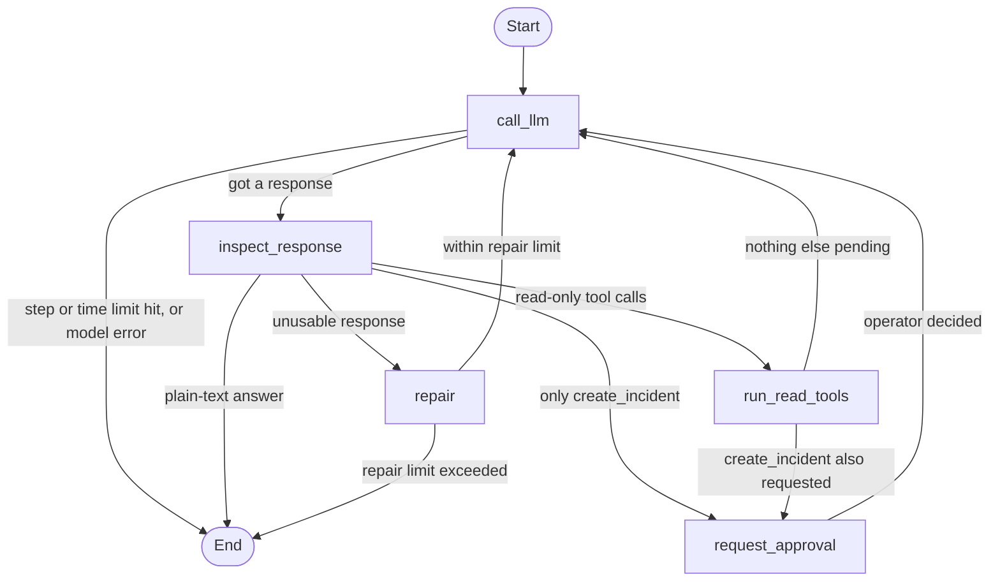

# Ops Assistant Agent Harness: Report

## 1. Goal and approach

Build the control loop around an LLM, not the LLM itself. The harness accepts an objective, lets the
model call three mock tools, and guarantees that every run is validated, bounded, observable and,
for the one side-effecting tool, human-approved.

The loop is an explicit LangGraph state machine, so each guarantee is a visible node or edge instead
of a prompt instruction.

Steps in words:
1. `call_llm` asks the model what to do next. Before asking, it stops the run if the step or time limit is reached.
2. `inspect_response` checks the reply: a plain-text answer ends the run; an unusable reply goes to `repair`; tool calls are validated and sent on.
3. `repair` tells the model what was wrong and asks again, a limited number of times.
4. `run_read_tools` runs the read-only tools (with timeout and retry) and feeds results back to the model.
5. `request_approval` pauses the run until the operator approves or rejects `create_incident`, then the run continues.

| Requirement | How it is met |
|---|---|
| Objective via API or CLI | FastAPI endpoints and a Typer CLI over one `RunService` |
| LLM-tool loop | `call_llm -> inspect_response -> tools -> call_llm` |
| Validate inputs and outputs | Pydantic schema per tool: arguments checked before execution, results checked before reaching the model |
| State and history | Graph state checkpointed to MongoDB (`thread_id = run_id`); append-only `events` collection |
| Errors, timeouts, retries | Per-attempt timeout, bounded retry for transient errors and timeouts, permanent errors returned to the model as observations |
| Malformed LLM responses | Invalid JSON arguments, unknown tool, invalid arguments or empty reply trigger a corrective message, up to `MAX_REPAIRS`, then the run fails |
| No infinite loops | `MAX_STEPS` and `MAX_RUN_SECONDS` checked before every model call; each tool attempt is capped by the time left |
| Approval before `create_incident` | `interrupt()` pauses the run; the incident runs only after approval, with the stored approved arguments |
| Logs and traces | Every model call, tool call, retry, error, approval and limit is an event with timestamp and duration; JSON logs carry `run_id` |
| Tests | 75 offline tests plus one live test |

Design decisions worth knowing:
- **Mixed turns:** if one model turn requests read tools and `create_incident`, the read tools run first and only the incident waits for approval.
- **Rejection:** returned to the model as the tool result, so it can explain and finish; the run ends `COMPLETED`.
- **Paused time is free:** time waiting for the operator does not count toward the run time limit.
- **Idempotent incidents:** a unique key `run_id:tool_call_id` makes retries and duplicate approvals create at most one incident.
- **Approval integrity:** the arguments to execute are read from the stored approval; if they differ from the request, nothing runs.
- **Untrusted tool output:** results are labelled as data and the system prompt says to ignore instructions inside them.
- **Privacy:** every OpenAI request is sent with `store=False`.

## 2. Technology stack

Python 3.12 (uv), FastAPI, LangChain + LangGraph (StateGraph, `interrupt`, MongoDB checkpointer),
OpenAI chat and embedding models, MongoDB Atlas Local (Docker) with Atlas Vector Search, pydantic,
structlog, pytest, ruff.

## 3. Database design (MongoDB)

| Collection | Key fields | Notes |
|---|---|---|
| `runs` | `_id` (run_id), objective, status, step_count, event_seq, final_answer, error, timestamps | Status: RUNNING, AWAITING_APPROVAL, COMPLETED, FAILED, LIMIT_EXCEEDED |
| `events` | run_id, seq, type, payload, ts, duration_ms | Append-only; unique `(run_id, seq)`; the trace |
| `approvals` | run_id, tool_call_id, tool_name, args, status, requested_at, decided_at | Unique `(run_id, tool_call_id)`; decision is a conditional update from PENDING |
| `incidents` | `_id` (INC-xxxx), title, description, severity, run_id, idempotency_key | Unique `idempotency_key` |
| `kb_chunks` | doc_id, title, text, tags, embedding (1536) | Atlas vector index `kb_vector_index` (cosine) |
| `checkpoints`, `checkpoint_writes` | LangGraph state | Lets a paused run resume after a restart |

MongoDB covers all of it, including semantic search for the knowledge base, so there is one store to run.

## 4. Postman collection

`postman/ops-assistant.postman_collection.json`: health, start (read-only and incident), approve,
reject, get run, get trace, and a validation error. `base_url` defaults to `http://localhost:8000`;
`run_id` is set automatically by the start requests.

## 5. Environment variables

See the table in `README.md`. Secrets only come from the environment; `.env` is git-ignored.

## 6. Mock dataset

`data/services.json` (6 services, healthy/degraded/down) and `data/kb/*.md` (16 runbook and policy
documents, 40 chunks). Both live in the repository.

## 7. Limitations

- Single process, no authentication, no multi-tenancy, no streaming.
- A run executes inside the HTTP request, so long runs block the caller and there is no job queue.
- Pending approvals never expire, and nothing notifies the operator.
- The checkpointer is synchronous and runs in a thread pool.
- Mock tools only; the incident system is a collection in the same database.
- The time limit counts model and tool time, not scheduling overhead.
- Failure injection counts calls per process, which is meant for tests and demos only.
- Retrieval quality is untested beyond a few queries; no reranking.

## 8. Future improvements

- Background workers with a queue and Server-Sent Events or webhooks for status and approval prompts.
- Approval expiry, reminders, roles and audit of who approved.
- Authentication and per-tenant data isolation.
- OpenTelemetry traces and LangSmith-style evaluation of runs.
- A policy engine deciding which tools need approval, and per-tool rate limits.
- Evaluation set for the knowledge base, hybrid search and reranking.
- Cost and token accounting per run.
